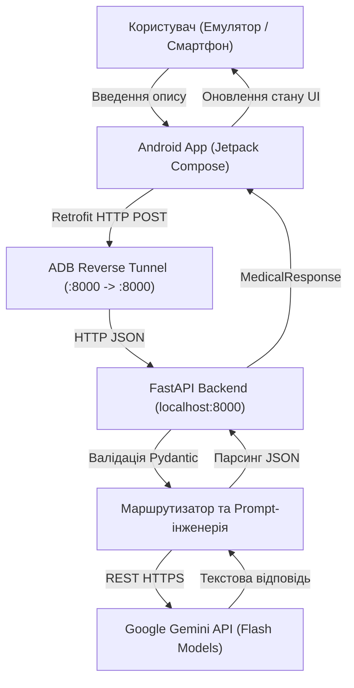
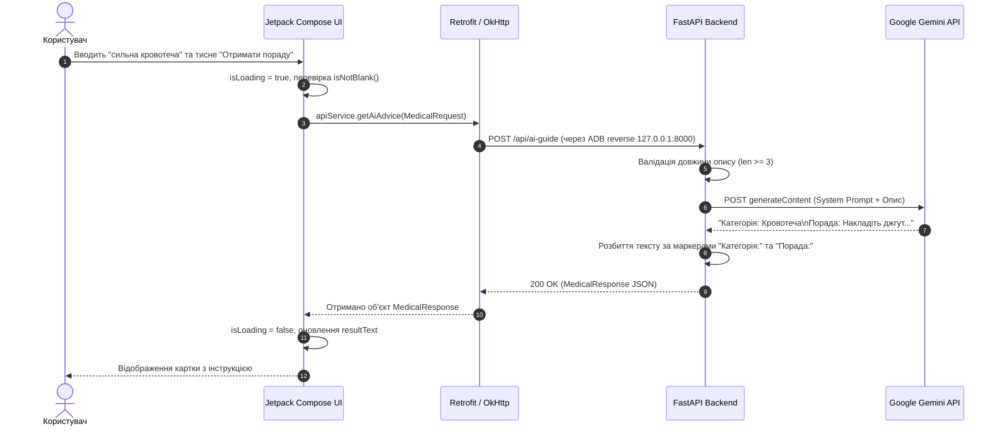

# Architecture: DefendWatch Med

## 1. Загальна архітектура системи

Система побудована за клієнт-серверною архітектурою з підключенням зовнішнього хмарного LLM-провайдера (Google Gemini API).

---

## 2. Основні компоненти

### 2.1. Мобільний клієнт (Mobile Client)
- **Платформа:** Android SDK (minSdk: 24, targetSdk: 37, compileSdk: 37).
- **Мова:** Kotlin.
- **UI Framework:** Jetpack Compose (Material3).
- **Архітектурний підхід:** Single Activity (`MainActivity.kt`) з реактивним стейтом (`remember { mutableStateOf(...) }`).
- **Мережевий рівень:** 
  - `ApiService.kt` — інтерфейс Retrofit з асинхронним методом `suspend fun getAiAdvice(...)`.
  - `RetrofitClient` — синглтон конфігурації Retrofit з кастомним `OkHttpClient` (таймаути 60с) та `GsonConverterFactory`.
  - Базова адреса: `http://127.0.0.1:8000/`.

### 2.2. Серверний бекенд (Backend Server)
- **Технологічний стек:** Python 3.12, FastAPI, Uvicorn, Pydantic v2, python-dotenv.
- **Точка входу:** `backend/main.py`.
- **Конфігурація середовища:** `backend/.env` (завантажується через `load_dotenv` з абсолютним визначенням шляху).
- **Ролі:**
  - Приймає вхідні запити від мобільного додатку.
  - Здійснює попередню фільтрацію та валідацію вводу.
  - Формує суворий медичний промпт-шаблон.
  - Здійснює безпечне спілкування з Google AI.
  - Парсить текстовий результат у структурований JSON.

### 2.3. AI-компонент (Google Gemini)
- **Моделі:** Сімейство Google Gemini Flash (`gemini-flash-latest`, `gemini-2.5-flash-lite`, `gemini-3.5-flash-lite`, `gemini-3.8-flash`).
- **Транспорт:** Оптимізований REST (`transport="rest"` замість блокуючого gRPC для Windows).
- **Конфігурація генерації:** `temperature=0.2`, `max_output_tokens=200`, `timeout=10s`.

---

## 3. Діаграма послідовності (Data Flow Sequence)

